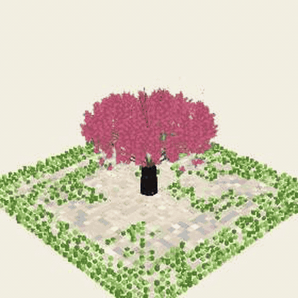

# Orbit

A plaza that turns on its own. Scroll down and the same ground lies flat as a QR code.



Day is a cherry tree on stone, with grass around the edge. Night is a solar system: a sun, planets on their own orbits, and an asteroid rim. The base keeps rotating until you scroll or drag downward. That flat picture is a colored code for the link in the field, and a phone can scan it.

## What you can change

- **Link.** The text in the field is what the code encodes.
- **Day / Night.** Grove or solar system. In day, the season buttons and the color dots change the blossoms.
- **An image.** Drag a picture onto the plaza, or use **Drop an image**. In day it becomes a block picture. In night it stands up as a blue wireframe hologram of that picture and keeps facing you while the plaza turns. Scroll down and it fades so the code can be scanned. **Clear image** brings back the tree or the planets.

A dropped photo does not become the code. The flat view has to stay a real QR of the link, or it will not scan. The picture is the 3D scene in front of that.

## Run

```bash
npm install
npm run dev
```

Open http://localhost:5174. Scroll over the plaza, or drag up and down. Drag sideways to turn it yourself. The hint under the picture jumps straight to the code.

```bash
npm test
npm run build
```
